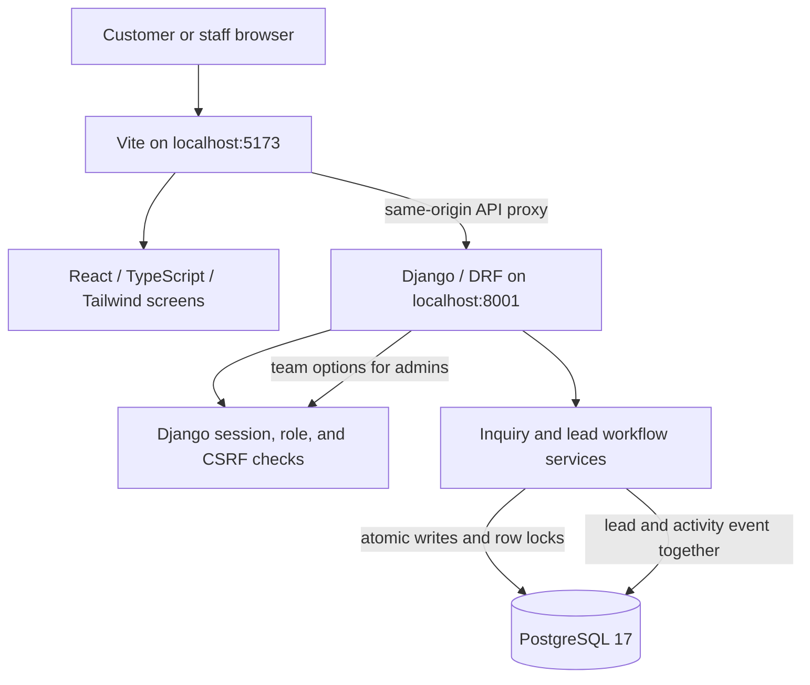

# Architecture — Milestone 3

## Responsibilities

- React Router provides customer inquiry, login, lead list, lead detail, and manual-entry screens. UI checks decide which controls to show; they do not authorize a write.
- Django sessions authenticate browser requests. The application role decides staff/admin actions, and CSRF protects every write. Django's separate technical admin flag controls access to Django admin.
- Inquiry and workflow serializers validate submitted fields and reject unknown/privileged fields. The API views connect those validated requests to the workflow services.
- CRM services own business rules. `workflow.py` locks one lead row, checks the expected version and role/owner, changes the lead, increments its version, and writes an activity event in one transaction.
- PostgreSQL constraints protect valid stages, closure fields, quotes, and action-key uniqueness. Row locks serialize claims so simultaneous staff claims have one winner.
- Each staff action has an idempotency key and a fingerprint of the actor and business fields. A repeated identical request returns the saved lead; changed content under the same key conflicts.
- Activity history uses readable summaries in the API. Note bodies and loss reasons remain private to authenticated staff; public inquiry responses still reveal only the opaque reference.
- PostgreSQL is also used for sessions and shared rate counters. No queue or Redis is needed for the current workflow. Scheduled work belongs to a later milestone.

## Lead workflow

Website intake creates a New, unassigned lead and its initial event together. Staff can also enter inquiries received by phone, email, WhatsApp, referral, or another source; the creator owns that entry. Admins assign or reassign leads to active team users. Staff can see all leads, claim unassigned active leads, and mutate only their assigned leads.

Recording customer contact writes the contact method, first-contact time (only if empty), and an activity event. A first contact on a New lead moves it to Contacted. Contact later than the first response remains in the history without changing the first-contact metric.

Contacted leads can receive a positive SGD quote and move to Quoted. Quoted leads can become Won. An open lead can become Lost only with a reason. Admins can reopen a closed lead; the prior close event remains in the append-only history. Calls, messages, and quotes are still performed manually.

## Concurrency and failures

All workflow mutation requests carry an expected lead version. If another request wins first, stale changes receive a conflict and the user must refresh. The client action key makes a retry safe after a lost response. Activity write failure rolls the lead change back, so no unrecorded mutation is committed.

The lost response case is handled before the version check when the same action key, actor, and payload already have an event. This avoids repeating contact notes or business effects. A reused key with changed payload is rejected.

Public inquiry behavior remains transactional and idempotent on the original submission key. No external message is sent in Milestone 3.

## Local and production operation

PostgreSQL runs in one dedicated local Docker container and volume; only localhost port 55432 is published. Django and Vite run as ordinary local processes. Production settings do not read the local `.env` and require secure host/TLS configuration. Production will serve the compiled frontend and API from one origin.

## Later work

Milestone 4 adds follow-up tasks and overdue views. Milestone 5 adds pipeline reporting, filters, exports, and dashboard metrics. Milestone 6 records external email executions with bounded retries and verified webhooks. Hosted synthetic demo, backups, restore and release rollback remain Milestone 7.
