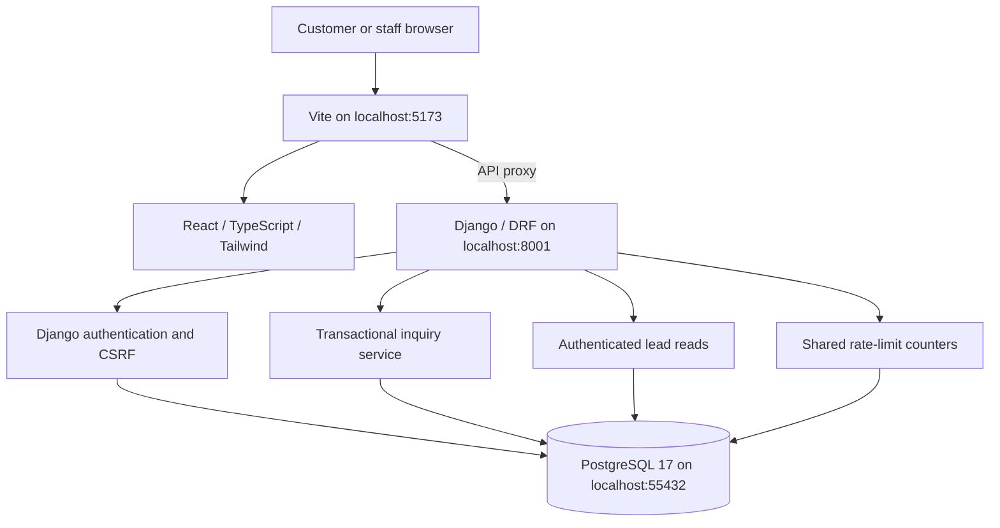

# Architecture — current local implementation

## Responsibilities

- React Router provides directly addressable inquiry, login, list, and detail screens.
- AuthProvider keeps session state, protects screen navigation, and cancels obsolete session reads after login/logout. Server permissions independently protect data.
- The API client obtains a fresh CSRF token before writes, includes same-origin cookies, bounds requests, and exposes predictable errors.
- Django AuthenticationForm and session functions handle credentials, password hashing, login rotation, fixed expiry, and logout.
- InquirySerializer validates public fields and rejects privileged/unknown input.
- The CRM service hashes the normalized original payload and commits Lead plus initial ActivityEvent together.
- PostgreSQL enforces unique submission keys. A concurrent losing insert rolls back before reading/replaying the winner. A changed payload under the key conflicts.
- Shared rate counters use database row locks and hashed identifiers. No cache service, queue, or Redis is needed.
- Lead list/detail are read-only to authenticated staff/admin. Staff see the whole team pipeline; write permissions arrive with ownership in Milestone 3.
- Readiness still runs a real PostgreSQL query and returns minimal success/unavailable states.

## Local operation

PostgreSQL runs in one dedicated Docker container and volume; only localhost port 55432 is published. Django and Vite run as normal local processes. Port 8001 avoids another Docker application's existing port 8000.

Local settings load the ignored root .env without replacing exported values. Production settings do not load it and reject missing secrets/hosts/TLS configuration. The local-account helper is restricted to DEBUG plus a local database and writes generated passwords only to an ignored private file.

The custom user predates initial migrations. CRM services explicitly validate models; save alone does not run full validation. Bulk updates must never change original submission identity.

## Failure behavior

Validation does not create records. A failure writing the creation event rolls back the lead. A lost/uncertain response is retried using the same key and unchanged payload, so either the first stored lead is returned or one new record is created. Client details remain locked during uncertain retries. Only the opaque key is retained in session storage; customer fields stay in component memory.

A 403 not_authenticated expires client session state and returns the user to login. Reloading a private URL checks the server session before rendering records.

## Later work

Milestone 3 adds ownership and transactional mutation permissions, contact/stage actions, notes, and their history. Follow-up tasks, reporting, and external alerts follow.

Production will serve the compiled frontend and API from one origin. Integration executions will be created alongside future inquiry transactions and processed by a scheduled command after commit, with provider idempotency and verified webhooks. Those integrations and production asset hosting are not implemented yet.
