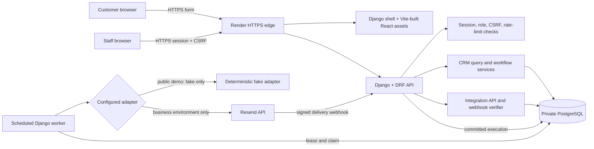

# Architecture — current implementation

## Responsibilities

- **React and TypeScript** own form state, navigation, filters, and work-oriented display states. UI controls are not an authorization boundary.
- **Django and DRF** authenticate via Django sessions and CSRF, validate API input, apply role/owner checks, and return a consistent API error shape.
- **`crm/`** owns lead/task data and business rules: idempotent inquiry creation, owner workflows, task scheduling, archival, filtering, exports, and dashboard calculations. Views pass validated values into services; they do not replace those rules.
- **`integrations/`** owns fake and Resend adapters, email execution/attempt rows, short worker leases, retry window, signed webhook verification, and provider event deduplication.
- **`operations/`** owns request limits, health checks, synthetic seed/reset commands, and management-time safeguards.
- **PostgreSQL** stores all business data, sessions, shared rate counters, activity history, integration execution state, and worker heartbeat. Row locks and unique constraints coordinate concurrent requests and retries.
- **Render web service and cron jobs** provide the demo runtime. One origin avoids a separate CORS/cookie deployment. WhiteNoise serves Vite's content-hashed files. The cron jobs use PostgreSQL leases, so no broker or Redis is needed for this small workload.

## Inquiry to follow-up and alert

1. The browser fetches CSRF and public configuration, validates required fields for usability, and submits an allowlisted inquiry with a stable submission UUID.
2. Django applies public-mode guards, rate limiting, honeypot/schema validation, and normalized payload validation. A database transaction creates the lead, initial activity event, and exactly one pending alert execution. A repeat key with the same payload returns the existing reference; changed content under the same key conflicts.
3. Staff sign in, see all active team leads, and claim an unassigned lead or ask an admin to assign it. The lead service locks the row, checks current version/role, and records the ownership event atomically.
4. The owner records contact/stage changes, append-only notes, and dated follow-ups. Due times are timezone-aware instants; the UI displays Asia/Singapore. A task becomes overdue by comparing its pending state and due instant to current server time, not via a scheduled status rewrite.
5. A worker claims due executions with `select_for_update(skip_locked=True)`, creates an attempt, and commits a short lease before making a network request. It does not hold a database transaction open over the network. The provider idempotency key is stable for that execution.
6. The worker records accepted/failure/uncertain outcomes. A signed provider webhook is verified against the unmodified request body and deduplicated by provider event ID. Early and out-of-order receipts are reconciled by provider message ID.

## Failure behavior

- **Duplicate public submission:** identical key and payload replays the receipt; altered payload returns conflict; only one alert execution is stored.
- **Duplicate lead by contact method:** allowed, because a customer may ask about separate jobs. Staff can find likely duplicates by search; automatic fuzzy merging is intentionally out of scope.
- **Network timeout:** the execution retains the same idempotency key and enters bounded retry when safe. Unknown outcomes that cannot be safely retried become Needs review.
- **Provider failure:** retry temporary errors up to five attempts at bounded intervals; permanent delivery failures are visible but not automatically retried.
- **Worker crash:** the lease expires; a later run reclaims it and records the prior attempt as uncertain. After the safe provider window/attempt limit, the execution is surfaced for review.
- **Overdue work:** computed on read from pending + past-due; completing, cancelling, or rescheduling writes a versioned activity event.
- **Archived lead:** admin-only archive records history, cancels pending tasks, and hides the lead from active staff lists. Restore does not resurrect cancelled work.

## Metrics

The API returns the generation timestamp, current active stage counts, 30-day intake count, open leads awaiting first contact, overdue pending tasks, current Quoted-stage value, first-response median/coverage, and a mature 90-day intake-cohort win rate. Response time is `first_contact_at - received_at`; the win denominator is leads received from 120 to 30 days before the generated timestamp. Exact exclusions and boundaries are in [Milestone 5 metric definitions](milestone-5.md). Quoted value is not revenue.

## Security, deployment, and growth boundary

Staff can read team leads but edit only leads they own. Admin role controls assignment, archive/restore, export, and integration retry. Technical Django `is_staff`/`is_superuser` is distinct from the application role. Public demo mode forces fake delivery and blocks public intake in the backend.

Production will serve the SPA shell, assets, and `/api/` on one secure origin. Render's Singapore region holds web/cron/DB together. A managed PostgreSQL database is the single source of truth; scheduled jobs use durable rows and leases. If volume later requires concurrent worker scale, queued asynchronous tasks, or tenant isolation, reassess broker and tenancy design separately. No multi-business tenancy or billing exists in this MVP.
